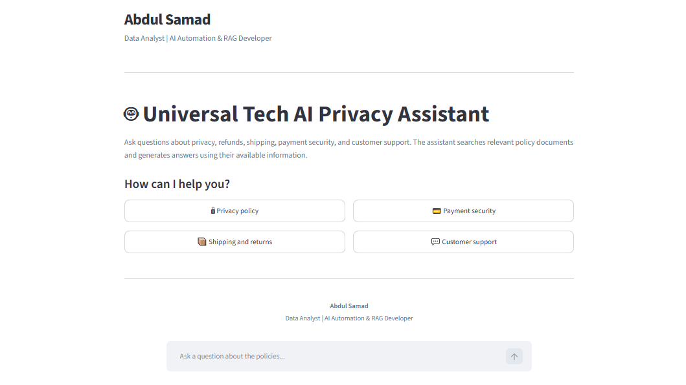
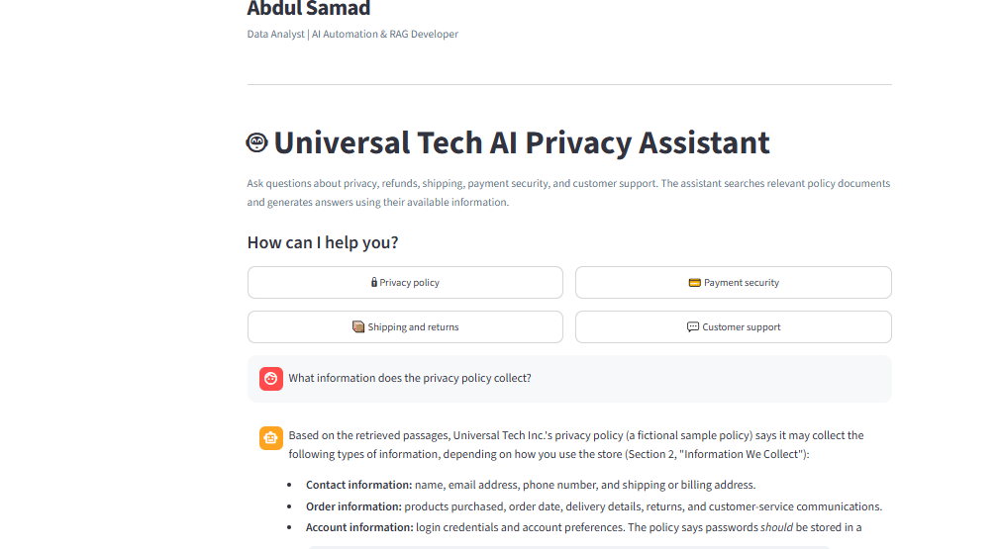
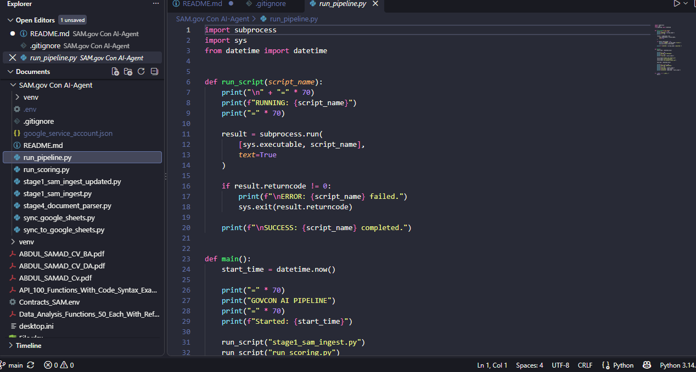

# Universal Tech AI Privacy Assistant

**Developed by Abdul Samad**  
*Data Analyst | AI Automation & RAG Developer*

A document-question-answering application built with Python, Streamlit, Retrieval-Augmented Generation (RAG), ChromaDB, Sentence Transformers, and the Anthropic Claude API.

The application retrieves relevant passages from a knowledge base and uses them to generate answers to questions about privacy, shipping, refunds, payment security, and customer support.

## Screenshots

### Main Interface



### Answer with Supporting Sources



### Project Structure



## Features

- Ask questions about policy documents using natural language.
- Retrieve relevant document passages using semantic search.
- Generate answers using the Claude API.
- Display retrieved source passages for review.
- Support follow-up questions through conversation history.
- Handle questions when the retrieved evidence is insufficient.
- Evaluate retrieval and answer grounding using a separate evaluation script.

## Technology Stack

- **Python** — application logic and document processing
- **Streamlit** — interactive web interface
- **Sentence Transformers** — text embeddings
- **ChromaDB** — vector storage and semantic retrieval
- **Anthropic Claude API** — answer generation
- **python-dotenv** — environment variable configuration

## Project Structure

```text
universal_tech_privacy_rag/
├── app.py
├── ingest.py
├── evaluate_rag.py
├── requirements.txt
├── .env.example
├── .gitignore
├── README.md
├── Knowledege_base/
│   ├── customer_support.md
│   ├── payment_security.md
│   ├── privacy_policy.md
│   ├── refund_policy.md
│   └── shipping_returns.md
└── screenshots/
    ├── rag_home.png
    ├── rag_answer_sources.png
    └── rag_project_structure.png
```

The `chroma_db/` directory is generated locally when the documents are indexed. It is excluded from Git.

## Requirements

- Python 3.10 or newer
- An Anthropic API key with access to the configured model
- Internet access for API requests and any first-time model downloads

## Installation

Open PowerShell in the project directory.

Create and activate a virtual environment:

```powershell
python -m venv .venv
.venv\Scripts\Activate.ps1
```

Install the dependencies:

```powershell
python -m pip install --upgrade pip
pip install -r requirements.txt
```

Create your local environment file:

```powershell
Copy-Item .env.example .env
```

Open `.env` and enter your own Anthropic API key and the model configuration used by the application.

Never publish your real API key.

## Index the Documents

Build the local vector database:

```powershell
python ingest.py
```

The ingestion script reads the knowledge-base documents, creates embeddings, and stores the indexed passages in ChromaDB.

Run ingestion again when you need to refresh the indexed documents.

## Run the Application

Start Streamlit:

```powershell
streamlit run app.py
```

Open the local URL displayed in the terminal, usually:

`http://localhost:8501`

## Run the Evaluation

Run the evaluation script:

```powershell
python evaluate_rag.py
```

The script evaluates selected questions and produces evaluation reports according to its configured tests.

A previous evaluation run reported:

- 7 of 7 tests successful
- Expected source retrieved in 6 of 6 applicable cases
- 7 grounding verdicts marked supported
- 1 of 1 unanswerable-question abstention test passed

These results describe a previous run and do not guarantee correctness for all questions. Review the generated reports and test the application again after changes.

## How RAG Works

1. Load the policy documents.
2. Split the text into smaller passages.
3. Convert passages into embedding vectors.
4. Store the vectors and text in ChromaDB.
5. Convert the user's question into an embedding.
6. Retrieve relevant passages using semantic search.
7. Provide the retrieved context and question to Claude.
8. Display the generated answer and supporting passages.

## Limitations

- Universal Tech and its policy documents are fictional sample content.
- Answers depend on document quality, retrieval relevance, and language-model behavior.
- Retrieved sources should be reviewed; their presence does not prove every statement is supported.
- The application is an educational project, not legal advice or a verified compliance solution.
- Do not use real customer data without appropriate authorization and privacy safeguards.

## Security

- Keep `.env` and API credentials private.
- Do not commit API keys, virtual environments, or private customer data.
- Review files before publishing the repository.
- Configure API usage limits and monitor costs.

## Author

**Abdul Samad**  
Data Analyst | AI Automation & RAG Developer
